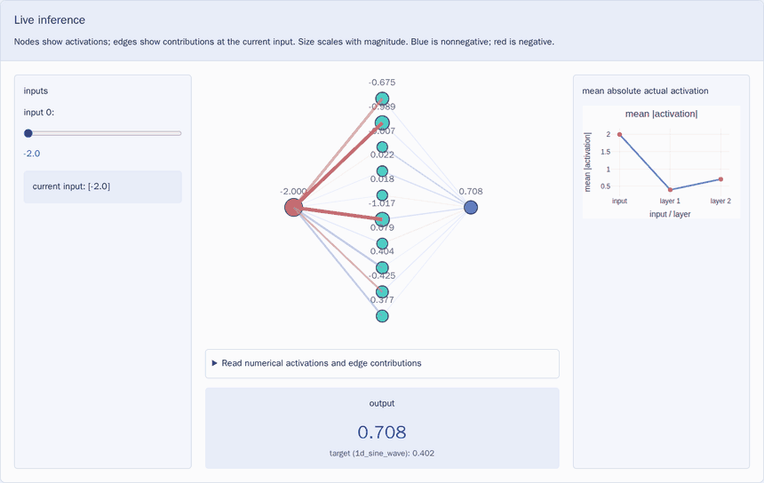

# kan-visualizer

A [browser viewer](https://mottopanikeiku.github.io/kan-visualizer/) for small networks whose edges are learned curves. Each edge computes a base activation plus a weighted sum of fixed Gaussian bumps. [Liu et al.'s KAN](https://arxiv.org/abs/2404.19756) uses B-splines there; [FastKAN](https://github.com/ZiyaoLi/fast-kan) made the same swap to Gaussians.



The viewer ships three trained models, a 1D sine wave, a 2D Gaussian wave and `sin(xy) + 0.5 tanh(x-y)`, with four views of each:

- Network graph. Click any node or edge; edge width shows the edge's typical output size.
- Edge functions. The learned curve on any edge, with the Gaussian centers marked.
- Live inference. Drag the inputs and every activation and edge contribution recomputes in the browser.
- Training history. Recorded loss by epoch.

## Against plain MLPs

On the 1D sine wave, the Gaussian-edge network beat MLPs of the same depth and parameter count in all five seeds. On both 2D targets it lost in all five, with 4.5 to 100 times the MLPs' median error.

| Target | Gaussian edge | MLP Tanh | MLP SiLU |
| --- | ---: | ---: | ---: |
| `sin(3x) + 0.3 cos(10x)` | 0.032 | 0.050 | 0.052 |
| `sin(x) exp(-y²)` | 0.0018 | 0.00029 | 0.00040 |
| `sin(xy) + 0.5 tanh(x-y)` | 0.020 | 0.00069 | 0.00020 |

Median MSE on a held-out grid. Every model saw the same data, minibatches and Adam steps; the parameter matching is in [docs/GUIDE.md](docs/GUIDE.md) and all 45 runs are plotted in [mlp-comparison.svg](assets/mlp-comparison.svg).

## Running and retraining

The viewer is static:

```sh
python3 -m http.server 8002 --directory web
```

Retraining the models or rerunning the comparison needs Python 3.13, [uv](https://docs.astral.sh/uv/) and Node. The lockfile installs CPU PyTorch.

```sh
uv venv --python 3.13
uv pip sync --index-strategy unsafe-best-match --python .venv/bin/python requirements.lock
.venv/bin/python test_kan.py
```

The layer equation, export format and comparison commands are in [docs/GUIDE.md](docs/GUIDE.md). Training uses [PyTorch](https://pytorch.org/) and the viewer [D3](https://d3js.org/) and [Plotly](https://plotly.com/javascript/). MIT license.
